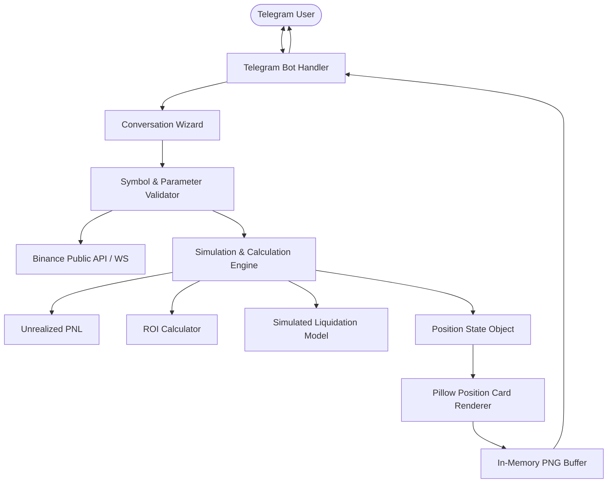

# Architecture Documentation

## 1. System Overview

The **Telegram Paper Position Generator** is a Python 3.12+ application designed to simulate cryptocurrency futures positions and render photorealistic Binance-style position cards for Telegram users without executing any live orders.

---

## 2. Core Modules

### 2.1 `app/binance`
- **`exchange_info.py`**: Fetches and caches symbol metadata from `GET /fapi/v1/exchangeInfo`. Extracts tick size (`PRICE_FILTER`), step size (`LOT_SIZE`), price precision, and trading status.
- **`client.py`**: Async HTTP client (`httpx`) targeting public endpoints (`/fapi/v1/premiumIndex`, `/fapi/v1/exchangeInfo`).
- **`websocket.py`**: Public WebSocket connection (`wss://fstream.binance.com/ws/{symbol}@markPrice`) for real-time price updates.

### 2.2 `app/simulation`
- **`models.py`**: Type-safe dataclass/Pydantic definitions (`PositionInput`, `PositionResult`, `Side`).
- **`precision.py`**: High-precision `Decimal` formatting, quantization by tick size, and signed percentage utilities.
- **`pnl.py`**: Exact unrealized PNL formulas for Long and Short in USDT.
- **`roi.py`**: Percentage ROI calculation based on user margin.
- **`liquidation.py`**: Deterministic liquidation model based on user-provided Margin Ratio.
- **`calculator.py`**: Pipeline orchestrator combining all calculation steps.

### 2.3 `app/renderer`
- **`theme.py`**: Design tokens, dark Binance palette (`#0B0E14`, `#181A20`, `#0ECB81`, `#F6465D`), layout coordinates, paddings.
- **`typography.py`**: Font loader with fallbacks (Segoe UI, Arial, Default PIL font).
- **`assets.py`**: Programmatic drawing of coin avatar rounded squares, share icons, and divider lines.
- **`position_card.py`**: Generates a 1080x650 PNG containing all position metrics, action buttons, and a clean `[SIMULATED]` watermark badge.

### 2.4 `app/bot`
- **`conversation.py`**: ConversationHandler managing the 6-step prompt flow for `/position` and `/mock_position`.
- **`handlers.py`**: Callback query handlers for `[ REFRESH ]`, `[ EDIT ]`, and `[ DELETE ]`.
- **`keyboards.py`**: Inline keyboards for side selection and post-generation actions.

---

## 3. Strict Safety Policy

1. **Read-Only / Market-Data Only**: No endpoints with trade capability are supported or imported.
2. **Automated Safety Test**: `tests/test_security_safety.py` actively asserts that strings like `/fapi/v1/order` are never present in the codebase.
